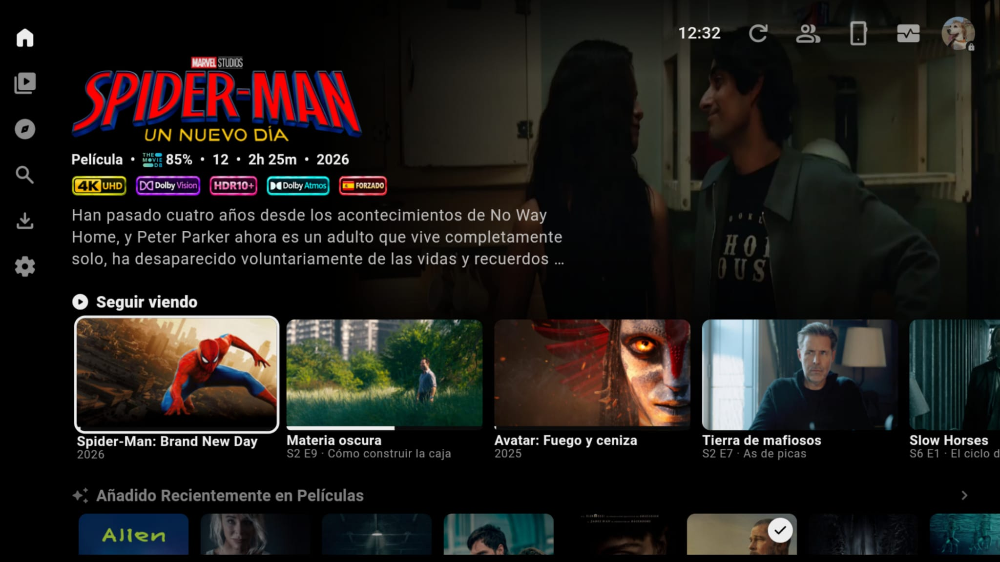
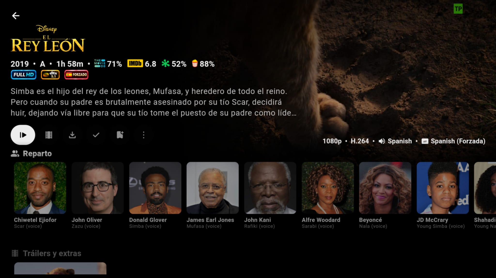
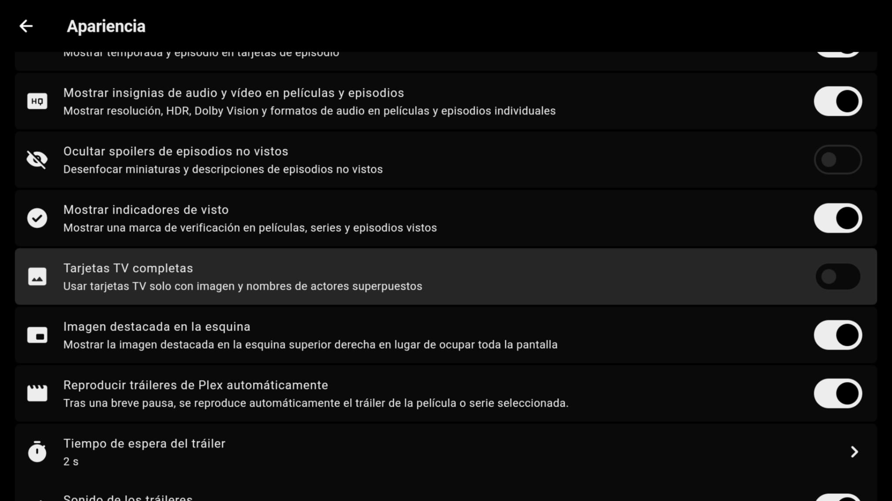

<h1>
  
  PlezyVision
</h1>

**PlezyVision** es una versión personalizada (*fork*) del proyecto de código abierto [Plezy](https://github.com/edde746/plezy), adaptada especialmente para disfrutar de una biblioteca multimedia en **Fire TV y Android TV**, con una presentación visual más cinematográfica.

El objetivo es que, al explorar películas y series, el protagonismo lo tengan las imágenes de fondo, los logotipos de los títulos y los tráileres, sin perder las funciones de reproducción y navegación de Plezy.

> **Proyecto independiente y no oficial.** PlezyVision se basa en Plezy, creado por [edde746](https://github.com/edde746). No está afiliado al proyecto original ni a Plex. Gracias al autor y a sus colaboradores por su trabajo.

## 📥 Descargar PlezyVision 1.0 Estable

**[Descargar PlezyVison.apk (ARM32)](https://github.com/Guatifo-dev/plezy_guatifo/releases/download/v1.0.0/PlezyVison.apk)** · [Ver la versión publicada](https://github.com/Guatifo-dev/plezy_guatifo/releases/tag/v1.0.0)

- **Versión estable de referencia:** `e9d2e82`.
- **Probada en:** Amazon Fire TV Stick 4K (ARM32).
- **Otros dispositivos:** puede funcionar en Android TV / Google TV que admitan aplicaciones Android ARM de 32 bits, pero no se ha verificado en todos ellos.
- **Instalación:** descargar la APK e instalarla en el dispositivo Android compatible. Si ya utilizas PlezyVision con la misma firma, puedes actualizar sin borrar tus datos.

La APK publicada es la versión estable ya compilada; esta documentación no modifica su funcionamiento.

## ✨ ¿Qué aporta PlezyVision respecto a Plezy original?

PlezyVision conserva la base de Plezy e incorpora una experiencia de navegación y presentación personalizada:

### 🎞️ Tráileres automáticos integrados en la navegación
- Reproducción automática del tráiler de Plex al mantener seleccionada una película o serie durante un breve intervalo configurable.
- Tráiler integrado en la zona de imagen destacada (*fanart*), sin pasar a pantalla completa.
- **Continuidad del mismo tráiler al entrar en la ficha de detalles y volver a la selección:** no se reinicia ni se vuelve a esperar el temporizador para el mismo título.
- Detención del tráiler al iniciar la reproducción del contenido o al abandonar el título correspondiente.
- Opciones para activar o desactivar los tráileres automáticos y ajustar su tiempo de espera.

### 🎨 Inicio y descubrimiento con protagonismo del fanart
- Presentación con imágenes destacadas y logotipos gráficos de las películas y series.
- Secciones **«Todas las Películas»** y **«Todas las Series»** para recorrer el catálogo desde la interfaz de descubrimiento.
- Navegación que mantiene el estilo de fanart en lugar de convertirse en una cuadrícula tradicional de pósteres.
- Se conserva el título de texto debajo de las tarjetas de contenido.
- Ajustes de transiciones para reducir destellos, interrupciones y reinicios visuales al navegar.

### 🏷️ Insignias técnicas de vídeo y audio
- Logotipos visuales para formatos compatibles detectados en el contenido, como **4K, Dolby Vision, HDR10+, Dolby Atmos, DTS-HD MA y Dolby TrueHD**.
- Presentación compacta de las insignias, adaptada a una sola línea cuando corresponde.
- **4K solo se indica cuando el contenido es realmente 4K**; no se añade una insignia innecesaria de 1080p.
- Interruptor en **Apariencia** para mostrar u ocultar la información técnica.

Las insignias dependen de los metadatos disponibles para cada archivo; no implican que el dispositivo pueda reproducir necesariamente todos esos formatos.

### 📖 Sinopsis ampliada
- Acceso a una vista de **sinopsis completa y póster** mediante pulsación prolongada de OK/Seleccionar sobre una tarjeta compatible.
- Se mantiene el comportamiento habitual del botón de menú.

### 📺 Identidad visual para televisión
- Icono de PlezyVision con el triángulo amarillo y naranja, ampliado y con fondo transparente.
- Banner horizontal para launchers como **Projectivy**, utilizando el mismo símbolo, centrado y sin un cuadrado negro alrededor.
- Identificador de compilación/commit visible para reconocer la versión instalada.
- Paquete Android propio: `com.guatifo.plezy`, independiente de la instalación de Plezy original.

### 🔧 Personalización y mantenimiento
- Opciones de apariencia para los elementos visuales añadidos.
- Compilación Android ARM32 distribuida como APK instalable.
- Actualizaciones de PlezyVision sobre la instalación existente cuando se mantiene la misma firma, sin necesidad de desinstalar.

## 📸 Capturas y demostración

Así se ve PlezyVision en funcionamiento, con su navegación centrada en el fanart, los detalles de cada título y las opciones de personalización.

### Pantalla de inicio

### Detalles de una película

### Opciones de apariencia

### 🎥 Vídeo de demostración

**[▶ Ver la demostración de PlezyVision (MP4, unos 41 segundos)](media/04-demo.mp4)**

[Descargar el vídeo](https://github.com/Guatifo-dev/plezy_guatifo/raw/refs/heads/main/media/04-demo.mp4)

*Las capturas y el vídeo muestran una biblioteca personal de ejemplo; PlezyVision no distribuye contenido multimedia.*

## ℹ️ Notas importantes

- **PlezyVision no incluye películas, series ni acceso a servidores multimedia.** Necesitas tus propios servicios, credenciales y contenidos.
- Las mejoras anteriores describen las personalizaciones de este fork; **las funciones generales de reproducción, bibliotecas y servicios compatibles proceden del proyecto Plezy original**.
- El desarrollo y las pruebas de esta versión se han centrado en Fire TV. La compatibilidad y el rendimiento pueden variar en otros dispositivos.
- Esta es una versión estable de referencia. No se planean cambios funcionales en la APK 1.0 publicada.

## 🙏 Créditos y licencia

PlezyVision es un fork de **[Plezy](https://github.com/edde746/plezy)**. Todo el reconocimiento al proyecto original y sus colaboradores por la base de la aplicación.

El código derivado se distribuye conforme a la licencia [GPL-3.0](LICENSE). Consulta también las condiciones de marcas del proyecto original en [TRADEMARKS.md](TRADEMARKS.md). **PlezyVision** es una denominación independiente utilizada para distinguir este fork.
